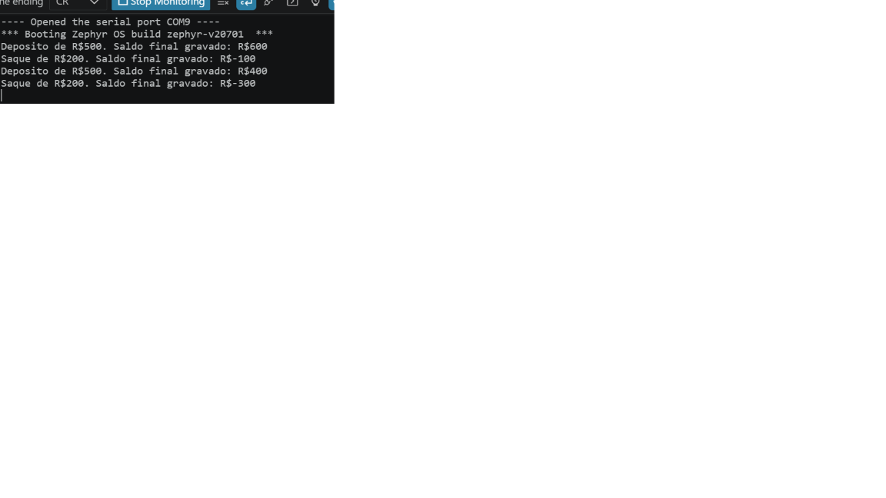
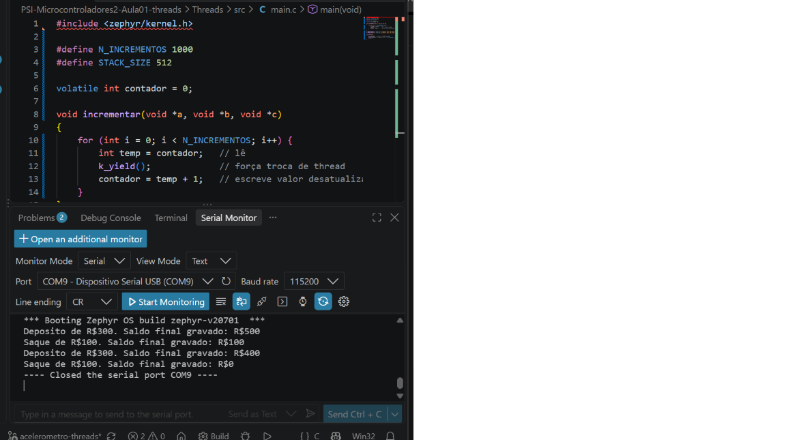
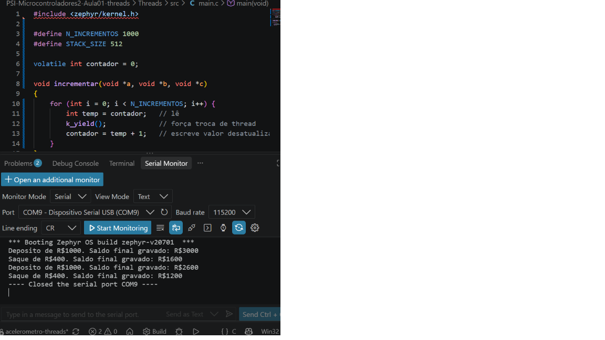
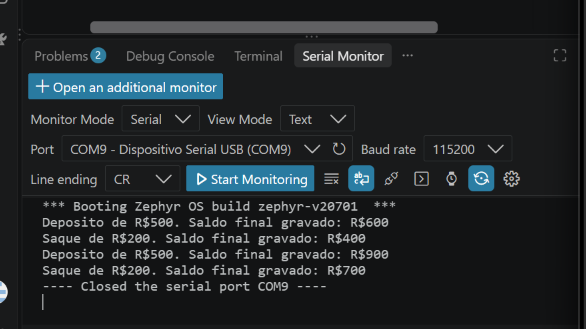
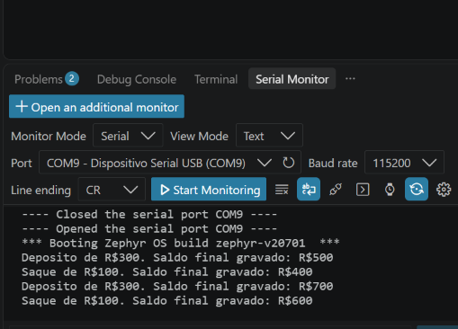
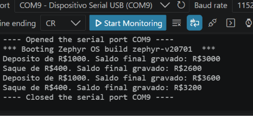

# Resolução de Race Condition com Semáforo ou Mutex - Ingrid, Giovanna e Gean

## 1. CRIAÇÃO DE CÓDIGO E AVALIAÇÃO CRUZADA

### Análise do código da Ingrid (feita pela Giovanna)
(espaço para documentar: o que ele faz, o comportamento incorreto observado e o momento em que o erro ocorre)

### Análise do código da Giovanna (feito pelo Gean)
(espaço para documentar: o que ele faz, o comportamento incorreto observado e o momento em que o erro ocorre)

### Análise do código do Gean (feita pela Ingrid):

O código simula uma conta conjunta. Duas threads de mesma prioridade (5) mexem na variável global `saldo_conta` (inicial 1000): uma faz depósito de R$500 e outra faz saque de R$200, repetindo a cada 2 segundos. Cada thread lê o saldo, espera 10 ms (`k_sleep`, simulando lentidão do sistema) e grava o valor calculado a partir da leitura.

**Comportamento incorreto observado:** o saque grava por cima do depósito, e o depósito se perde. Com o código original, a saída foi 1500, 800, 1300, 600. O correto seria 1500, 1300, 1800, 1600. O saldo cai R$200 a cada ciclo em vez de subir R$300.

**Momento em que o erro ocorre:** o saque começa 2 ms depois do depósito, dentro da janela de 10 ms em que o depósito está dormindo. Assim, as duas threads leem o mesmo saldo antes de qualquer uma gravar, e a última a gravar apaga a alteração da outra.

## 2. PLANEJAMENTO DE TESTES

### Planejamento de testes do código da Ingrid (feita pela Giovanna)
**Pré-condição para todos os testes**: (......)

**Teste 1**
(.....)

**Teste 2**
(.....)

**Teste 3**
(......)

### Planejamento de testes do código da Giovanna (feito pelo Gean)
**Pré-condição para todos os testes**: (......)

**Teste 1**
(.....)

**Teste 2**
(.....)

**Teste 3**
(......)

### Planejamento de testes do código do Gean (feito pela Ingrid)
**Pré-condição para todos os testes**: (......)

**Pré-condição para todos os testes:** placa FRDM-KL25Z com Zephyr 2.7.1; duas threads de prioridade 5 iniciadas no boot; saldo inicial, depósito e saque alterados no código antes de gravar; monitor serial na COM9 a 115200, com reset da placa antes de cada leitura.

**Teste 1** (saldo 100, depósito 500, saque 200)
- Etapas: gravar o código, abrir o monitor serial, apertar reset e ler as 4 primeiras linhas.
- Pós-condição esperada: depósito grava 600 e saque grava 400 (depois 900 e 700).
- Obtido no original: 600, **-100**, 400, -300 (falhou).
- 

**Teste 2** (saldo 200, depósito 300, saque 100)
- Etapas: as mesmas.
- Pós-condição esperada: 500 e 400 (depois 700 e 600).
- Obtido no original: 500, **100**, 400, 0 (falhou).
- 

**Teste 3** (saldo 2000, depósito 1000, saque 400)
- Etapas: as mesmas.
- Pós-condição esperada: 3000 e 2600 (depois 3600 e 3200).
- Obtido no original: 3000, **1600**, 2600, 1200 (falhou).
- 

## 3. CORREÇÃO E RETESTE

### Planejamento de testes do código da Ingrid (feita pela Giovanna)
**Pré-condição para todos os testes**: (......)

**Teste 1**
(.....)

**Teste 2**
(.....)

**Teste 3**
(......)

### Planejamento de testes do código da Giovanna (feito pelo Gean)
**Pré-condição para todos os testes**: (......)

**Teste 1**
(.....)

**Teste 2**
(.....)

**Teste 3**
(......)

### Planejamento de testes do código do Gean (feito pela Ingrid):

**Pré-condição para todos os testes**:

**Mudança feita:** foi adicionado um mutex (`K_MUTEX_DEFINE(saldo_mutex)`) em volta de leitura, espera e escrita, nas duas threads. Cada thread trava o mutex antes de ler o saldo e libera depois de gravar, então o saque só lê o saldo depois que o depósito terminou, e vice-versa. Escolhi mutex porque o problema é de exclusão mútua: só uma thread por vez pode alterar `saldo_conta`, e quem trava é quem libera. Código: `codigo_corrigido/gean/Gean.Corrigido.c`.

**Teste 1** (saldo 100, depósito 500, saque 200)
- Obtido: 600, 400, 900, 700. Passou.
- 

**Teste 2** (saldo 200, depósito 300, saque 100)
- Obtido: 500, 400, 700, 600. Passou.
- 

**Teste 3** (saldo 2000, depósito 1000, saque 400)
- Obtido: 3000, 2600, 3600, 3200. Passou.
- 

## 4. AVALIAÇÃO INTERNA

### Avaliação (Ingrid) 

**O que estava errado antes?**
O saque gravava por cima do depósito, e o depósito era perdido. No teste 1, depois do saque o esperado era 400 e o obtido foi -100, deixando o saldo negativo. Isso acontecia porque as duas threads liam `saldo_conta` antes de qualquer uma gravar, e o `k_sleep` abria essa janela.

**O que mudou com a correção?**
O mutex passou a cobrir leitura, espera e escrita nas duas threads. Cada uma só começa a operação depois que a outra terminou.

**O comportamento agora é estável?**
Sim. Nos três testes, o saldo ficou igual a saldo anterior + depósito − saque a cada ciclo (por exemplo, no teste 1: 600, 400, 900, 700), e nenhum depósito foi perdido.

### Avaliação (Giovanna)

**O que estava errado antes?**
(.....)

**O que mudou com a correção?**
(.....)

**O comportamento agora é estável?**
(.....)

### Avaliação (Gean)

**O que estava errado antes?**
(.....)

**O que mudou com a correção?**
(.....)

**O comportamento agora é estável?**
(.....)
